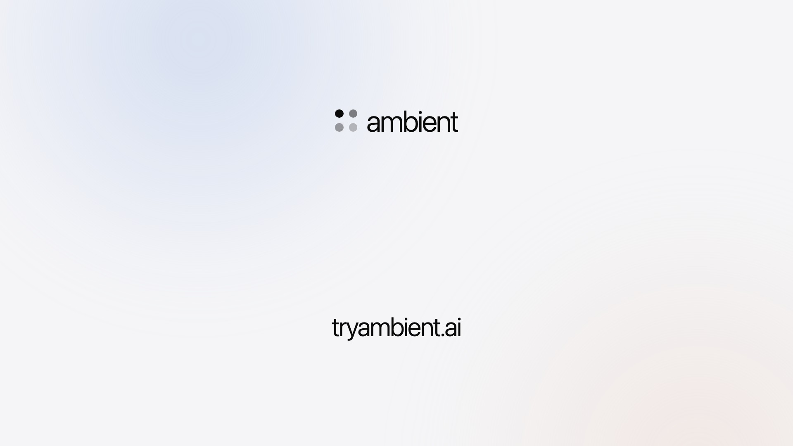
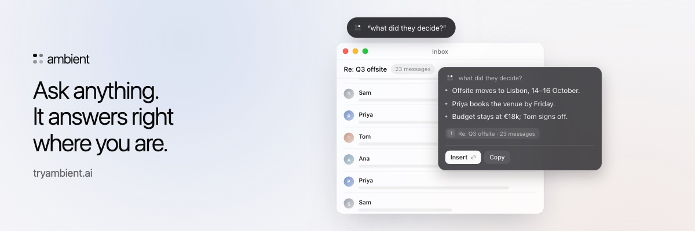

<p align="center">
  <a href="https://tryambient.ai">
    <picture>
      <source media="(prefers-color-scheme: dark)" srcset="web/public/brand/ambient-lockup-dark.svg">
      
    </picture>
  </a>
</p>

<p align="center"><strong>Your desktop colleague.</strong></p>

<p align="center">
  <a href="https://tryambient.ai/download"></a>
  <a href="https://tryambient.ai"></a>
</p>

Ambient lives on your desktop and works where you are. Talk to it and it
writes, answers, acts and remembers. It takes meeting notes without a bot, and
offers help on screen when it can (it never talks out loud). Dictation is free
and unlimited, and your voice is turned into text on your own computer.

<p align="center">
  <a href="https://tryambient.ai">
    <picture>
      <source media="(prefers-color-scheme: dark)" srcset="docs/assets/ambient-launch-dark.jpg">
      
    </picture>
  </a>
</p>

<p align="center">
  <picture>
    <source media="(prefers-color-scheme: dark)" srcset="docs/assets/ask-card-dark.jpg">
    
  </picture>
</p>

## Why this code is public

So you can check what Ambient does with your voice, your screen and your
words, rather than take our word for it. Every privacy promise on
[tryambient.ai/privacy](https://tryambient.ai/privacy) maps to the code that
keeps it in [docs/VERIFY.md](docs/VERIFY.md), and
[docs/ARCHITECTURE.md](docs/ARCHITECTURE.md) shows what runs on your computer
and what crosses the network. The server side is here too, in `web/`.

## Download

Get Ambient for macOS, Windows or Linux at
[tryambient.ai/download](https://tryambient.ai/download).

## What's where

| Path        | What it is                                                                  |
| ----------- | --------------------------------------------------------------------------- |
| `src-tauri` | The app's core, in Rust: speech, the agent, screen reading, memory, network |
| `src`       | The app's interface, in React                                               |
| `web`       | tryambient.ai and the server the app talks to (Next.js)                     |
| `testing`   | The scenario suite that runs real moments through the app before release    |
| `video`     | The launch video and campaign images (Remotion)                             |
| `packages`  | The speech model catalog                                                    |
| `scripts`   | Checks and build helpers ([scripts/README.md](scripts/README.md))           |
| `.github`   | CI: code checks, builds and releases                                        |

## Checks

```bash
bun run lint                                   # interface code
cd src-tauri && cargo test                     # the app's core
bun run check:translations                     # every language complete
bun run check:egress                           # only the listed files reach the network
bun run test:scenarios                         # the scenario suite (testing/README.md)
```

## Licence

Copyright © 2026 Valenor Core Design FZCO. Ambient is proprietary. This code is public to read and review only: you may
not use, copy, modify, build or redistribute it. See [LICENSE](LICENSE).
Open-source code it includes keeps its own licence; see
[THIRD_PARTY_NOTICES.md](THIRD_PARTY_NOTICES.md). Security reports:
[SECURITY.md](SECURITY.md). Questions: legal@tryambient.ai.

## Acknowledgements

Ambient began as a fork of [Handy](https://github.com/cjpais/Handy) by CJ
Pais (MIT). Thank you.
