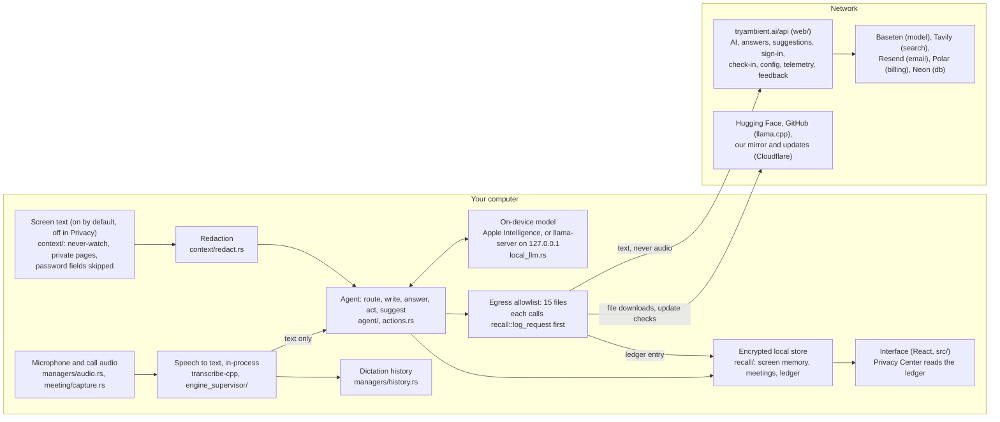

# Architecture

Ambient is a Tauri 2 desktop app: a Rust core (`src-tauri/`) that does the
work, a React interface (`src/`) that shows it, and a website with a small
API (`web/`, Next.js on Vercel) that the app calls for hosted AI, sign-in and
plans. [VERIFY.md](VERIFY.md) maps each privacy claim to the code below.

## Data flow

Everything left of the boundary runs on your computer. Only the boxes in
the allowlist (`scripts/check-egress.ts`) can cross it, and each one writes
what it sends to the local ledger first.

Audio stops at speech-to-text: from there only text moves on. The audio
modules contain no network code and call no module that sends
(`bun run check:egress` checks this).

## The window is only UI

The main window is only UI; everything runs in Rust and works with it
closed. Most people keep Ambient in the menu bar or tray: on macOS closing
the window hides it (and drops the Dock icon), a login item or
`--start-hidden` launch never shows it, and a hidden webview's JavaScript
and timers may be throttled or suspended (WKWebView, WebView2, WebKitGTK).
So nothing that does work lives in `src/`:

- Shortcuts and paste for a returning user start in Rust at launch
  (`init_input_at_startup` in `lib.rs`); the interface turns them on only
  at the end of onboarding.
- Every loop is a Rust thread or task: the agent loop (suggestions, meeting
  prep, screen memory), hands-free, meetings, plan and license refresh,
  check-in, telemetry, remote config, update checks, on-device AI.
- Cards, notices and the Esc/⏎ keys are the HUD's (`hud.rs`, `hud_keys.rs`),
  a window Rust creates and shows itself. An error the main window shows as
  a toast is also said on the HUD when the window isn't in front
  (`agent::notice::error_outside_window`).
- macOS opts out of App Nap (`NSAppSleepDisabled` in `Info.plist`) and
  Windows out of power throttling (`win/power.rs`).

Events the main window listens to only refresh what it shows. The scenario
suite runs every scenario with `--start-hidden` and no window at all, and
fails one that opens a window.

## Module map

### `src-tauri/src` (Rust)

| Area           | Modules                                                                                                                                                                                      | What they do                                                                                                                                                                                                                     |
| -------------- | -------------------------------------------------------------------------------------------------------------------------------------------------------------------------------------------- | -------------------------------------------------------------------------------------------------------------------------------------------------------------------------------------------------------------------------------- |
| Startup        | `lib.rs`, `main.rs`, `cli.rs`, `settings.rs`, `tray.rs`, `shortcut/`, `portable.rs`                                                                                                          | Tauri setup, managers, settings store, tray, global shortcuts, CLI flags.                                                                                                                                                        |
| Audio, speech  | `managers/audio.rs`, `audio_toolkit/`, `managers/transcription.rs`, `managers/transcription/`, `engine_supervisor/`, `language_detection/`, `vendor/ambient-recorder`, `vendor/ambient-cpal` | Capture, VAD (Silero), speech recognition through transcribe-cpp in a supervised worker, spoken-language detection.                                                                                                              |
| Dictation      | `transcription_coordinator.rs`, `actions.rs`, `clipboard.rs`, `paste_tx/`, `input.rs`, `corrections.rs`, `screen_names.rs`, `chinese_script.rs`                                              | From transcript to typed text: polish, smart writing, paste, learning corrections.                                                                                                                                               |
| Agent          | `agent/` (`router.rs`, `writing.rs`, `answer.rs`, `act.rs`, `proactive.rs`, `judge.rs`, `llm.rs`, `wake.rs`, `personal.rs`, `reminders.rs`, …)                                               | Decides, by reasoning over what was said and the screen, whether to type, write, answer or act; drafts, answers, actions, suggestions, hands-free. `agent/llm.rs` is the one place a model is called (and where No AI stops it). |
| Screen         | `context/` (`mod.rs`, `macos.rs`, `windows.rs`, `linux/`, `field.rs`, `judge.rs`, `sensitive.rs`, `redact.rs`), `swift/ambient_native.swift`, `win/`                                         | Reads window text through accessibility APIs, skips never-watch apps, private pages and password fields, redacts secrets.                                                                                                        |
| Memory         | `recall/` (`mod.rs`, `crypto.rs`), `managers/history.rs`                                                                                                                                     | Encrypted screen memory, meetings and network ledger (AES-256-GCM); dictation history.                                                                                                                                           |
| Meetings       | `meeting/` (`capture.rs`, `segmenter.rs`, `linux.rs`, `windows.rs`, `mod.rs`, `deliver.rs`)                                                                                                  | Mic and call audio, transcribed on device; notes, summaries, nudges; optional email of notes.                                                                                                                                    |
| Interface glue | `hud.rs`, `hud_linux.rs`, `hud_keys.rs`, `overlay.rs`, `intro.rs`, `commands/`                                                                                                               | The HUD panel (answer and suggestion cards), the recording overlay, Tauri commands for the React side.                                                                                                                           |
| On-device AI   | `apple_intelligence.rs`, `swift/apple_intelligence.swift`, `local_llm.rs`                                                                                                                    | Apple Intelligence on supported Macs; elsewhere a downloaded model run by llama-server on 127.0.0.1.                                                                                                                             |
| Plans, network | `plan.rs`, `limits.rs`, `llm_client.rs`, `checkin.rs`, `remote_config.rs`, `telemetry.rs`, `feedback.rs`, `updates.rs`, `managers/model.rs`, `managers/model/download.rs`, `catalog/`        | Trial, sign-in and license tokens; Free limits; the hosted-AI client; daily check-in; remote tunables; opt-in usage counts; feedback; updates; model catalog and downloads.                                                      |
| Testing        | `testing/`                                                                                                                                                                                   | The hidden test mode the scenario suite drives (needs `AMBIENT_TEST_MODE=1` and `--test-scenario`).                                                                                                                              |

### Elsewhere

| Path                  | What it is                                                                                                                                                                                                  |
| --------------------- | ----------------------------------------------------------------------------------------------------------------------------------------------------------------------------------------------------------- |
| `src/`                | React interface: settings, onboarding, Privacy Center (`components/privacy`), the HUD (`hud/`), i18n in 26 languages (`i18n/locales`).                                                                      |
| `web/app/api/`        | The server the app calls: `ai/v1` (hosted model), `agent/answer`, `agent/suggest`, `agent/config`, `auth/*`, `license/*`, `trial`, `usage`, `ping`, `telemetry`, `feedback`, `meetings/email`, `subscribe`. |
| `web/app/`, `web/lib` | The website (pricing, docs, privacy policy, terms) and server logic; `web/lib/db.ts` is the database.                                                                                                       |
| `testing/`            | Scenario suite: real moments run through the app's pipeline and graded; the release gate.                                                                                                                   |
| `packages/models`     | The speech model catalog, mirrored into `src-tauri/src/catalog/`.                                                                                                                                           |
| `video/`              | The launch video and campaign images (Remotion).                                                                                                                                                            |
| `.github/workflows/`  | Code checks (including the egress and licence checks), builds, the scenario suite and signed releases.                                                                                                      |
